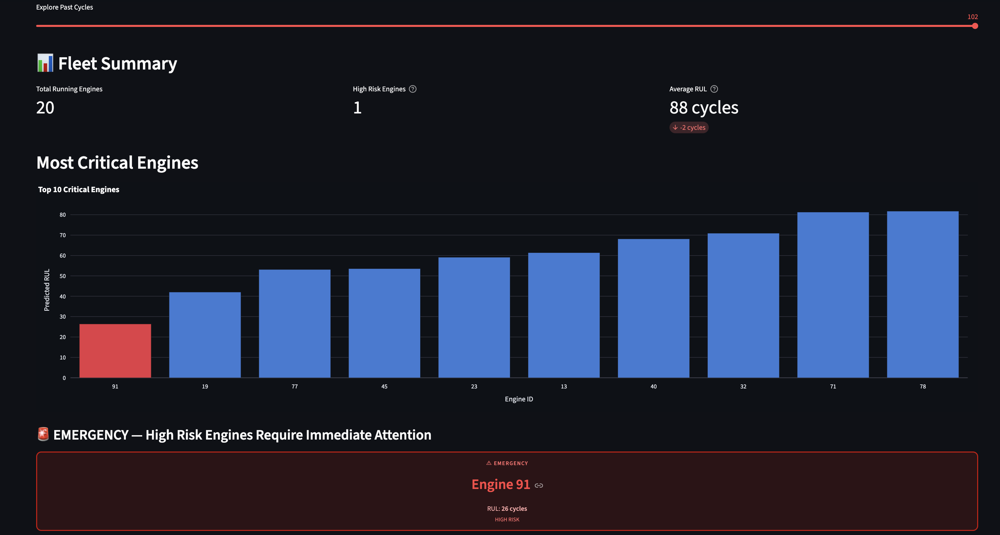
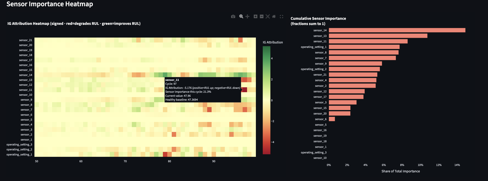
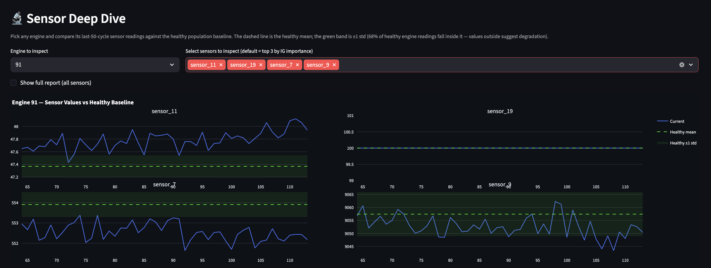
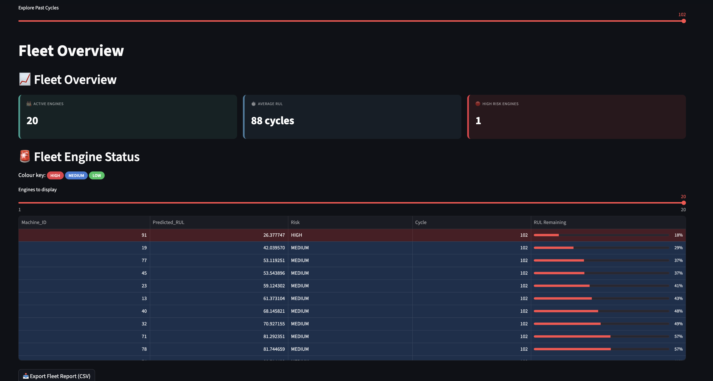
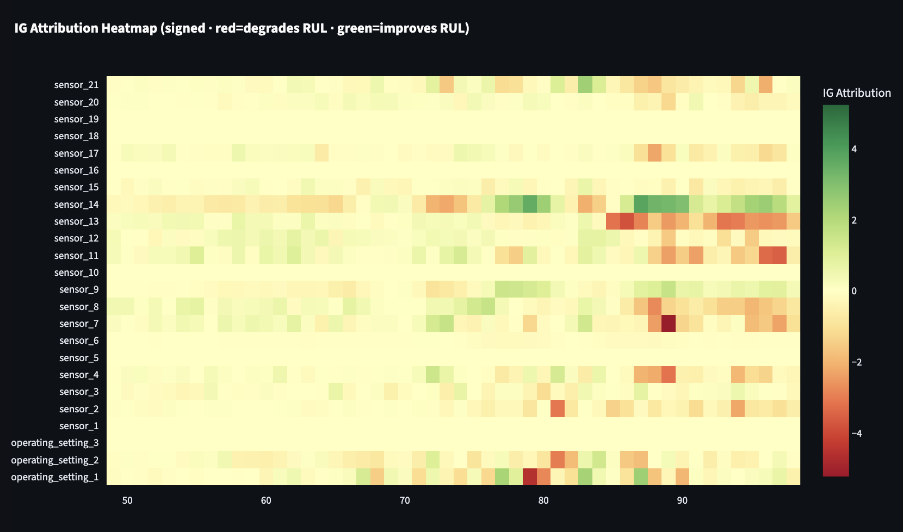
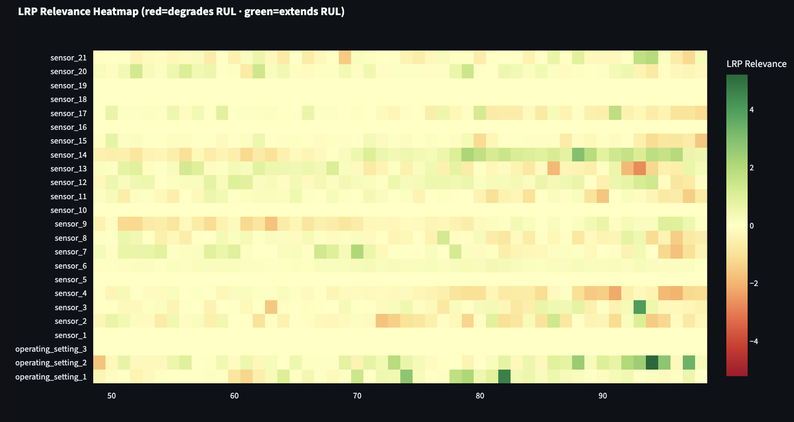
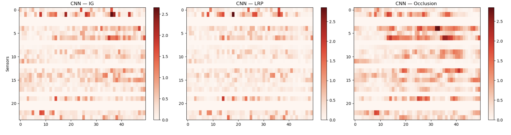
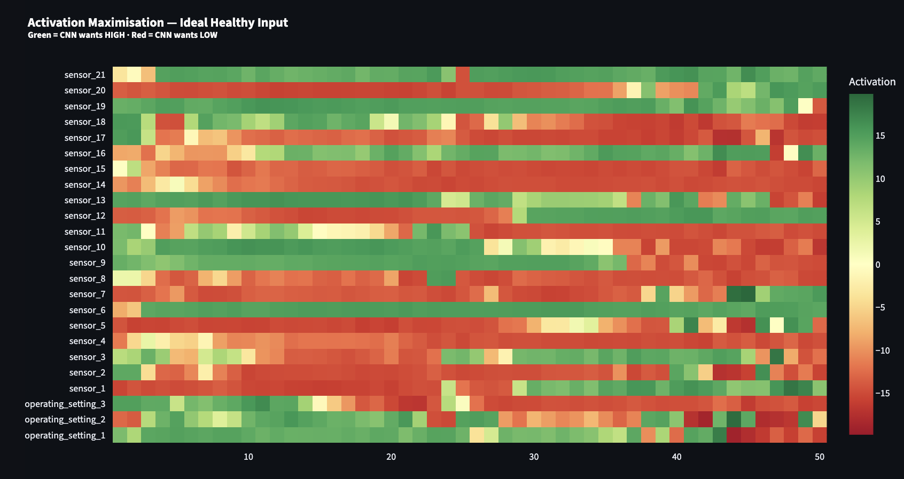
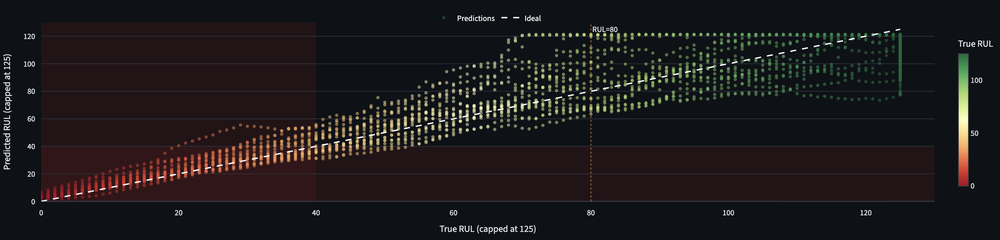

# Explainable Predictive Maintenance Dashboard

[](https://python.org)
[](https://pytorch.org)
[](https://xai-predictive-maintenance.streamlit.app/)
[](https://colab.research.google.com/github/mostafah404/xai-predictive-maintenance/blob/main/notebooks/data_preprocessing.ipynb)
[](LICENSE)

> A real-time predictive maintenance system that predicts the **Remaining Useful Life (RUL)** of turbofan engines and explains *why*, sensor by sensor, cycle by cycle.

**Live Demo → [Launch Dashboard](https://xai-predictive-maintenance.streamlit.app/)**  


**Notebook → [View in Google Colab](https://colab.research.google.com/github/mostafah404/xai-predictive-maintenance/blob/main/notebooks/data_preprocessing.ipynb)**

---

## What This Does

Most predictive maintenance AI systems tell you *when* a machine will fail, but not *why* they think so. This project fixes that by combining accurate deep learning models with multiple explainability (XAI) methods, all wrapped in an interactive dashboard built for two types of users: **operations managers** who need a quick fleet overview, and **maintenance engineers** who need to drill down into sensor-level details.

The system is trained and evaluated on the **NASA CMAPSS** turbofan engine dataset (FD001–FD004).

---

## Dashboard Screenshots

### Home Tab: Live Fleet Overview

*Fleet KPI cards, ranked critical engines bar chart, and emergency alerts, all updating in real time.*

### Maintenance Engineer Tab: XAI Deep Dive

*The tab automatically loads the most urgent engine in the fleet. The IG attribution heatmap (sensor × cycle) is paired with a cumulative attribution bar chart so engineers can see exactly which sensors, at which cycles, drove the prediction. A dropdown lets you switch to any engine in the fleet for a full side-by-side comparison.*


*Sensor deep dive view for the selected engine: each sensor's full history plotted against its healthy baseline band (±1σ). Sensors drifting outside the green band are immediately visible, letting engineers cross-check the XAI output against the raw data before taking action.*

### Operations Manager Tab: Fleet Risk Table

*Color-coded risk ranking table (red = HIGH, blue = MEDIUM, green = LOW) with a fleet health score and risk distribution chart.*

### Explainability: IG Attribution Heatmap

*Signed attribution heatmap: red cells flag sensor readings that are pushing the predicted RUL down (degradation), green cells show readings that support a longer life.*

### Explainability: LRP Heatmap (CNN)

*Layer-wise Relevance Propagation applied to the CNN model. For this engine LRP points to the same sensors and the same late cycles as IG.*

### XAI Method Comparison

*IG, Occlusion, and LRP side by side on the same CNN engine. All three point to the same sensors and the same time window.*

### Activation Maximization: Healthy Mode Profile

*The synthetic sensor pattern the CNN has learned to associate with maximum remaining life. Used to generate per-sensor maintenance recommendations.*

### Model Performance: True vs Predicted RUL

*True vs predicted RUL scatter plot. Each point is one 50-cycle window. Red points (HIGH-risk) cluster tightly around the ideal diagonal.*

---

## Tech Stack

| Component | Technology |
|---|---|
| Deep Learning | PyTorch |
| Models | LSTM + Attention, 1D CNN, Hybrid CNN-LSTM-BiLSTM |
| XAI | Captum (Integrated Gradients, Occlusion, LRP), Activation Maximization |
| Dashboard | Streamlit + Plotly |
| Data | NASA CMAPSS FD001–FD004 |
| ML Utilities | scikit-learn, scipy |

---

## Project Structure

```
xai_predictive_maintenance/
├── src/dashboard/
│   ├── app.py                      # Streamlit app (tabs, charts)
│   └── backend.py                  # data loading, model inference, XAI for the dashboard
│
├── notebooks/
│   ├── data_preprocessing.ipynb    # data preparation, training of the three models, dashboard examples,
│   │                               # multi-dataset run (FD001-FD004)
│   ├── reproduce_paper_results.ipynb   # every table and figure of the paper, outputs included
│   ├── rul_common.py               # model classes, FD001 loading, loading of the saved weights
│   ├── lrp_recurrent.py            # LRP written from scratch for the CNN, the LSTM and the hybrid model
│   ├── xai_analysis.py             # IG, Occlusion, LRP maps, agreement metrics, sensitivity, infidelity, activation maximization
│   ├── run_xai_analysis.py         # runs the whole explanation analysis, caches the result in results/fd001
│   ├── lrp_validation.py           # deletion test and epsilon sweep for LRP
│   ├── retrain_lstm_cnn.py         # trains the LSTM and the CNN again, saves the weights in data/
│   ├── performance_checkpoints.py  # RMSE, MAE, accuracy, S-score of the saved models
│   ├── trust_statistics.py         # statistics of the trust study (survey in data/)
│   ├── make_paper_assets.py        # figures (PDF) and LaTeX tables of the paper
│   ├── verify_paper_numbers.py     # compares the tables of the paper (paper/main.tex, not in the repository) with this repository
│   └── test_lrp_recurrent.py, test_xai_metrics.py    # tests
│
├── data/                           # CMAPSS files, survey answers, saved model weights (*.pth)
├── results/
│   ├── fd001/                      # saved results of the explanation analysis
│   └── paper/                      # figures and tables of the paper
├── assets/                         # screenshots for this README
├── requirements.txt
└── README.md
```

---

## Quick Start

### 1. Clone and install

```bash
git clone https://github.com/mostafah404/xai-predictive-maintenance.git
cd xai-predictive-maintenance
pip install -r requirements.txt
```

### 2. Run the dashboard

```bash
cd src/dashboard
streamlit run app.py
```

The dashboard will open in your browser at `http://localhost:8501`. It loads pre-trained model weights from the `data/` folder automatically.

> **Note:** The dashboard requires `model.pth` (LSTM) and `cnn_model.pth` (CNN) to be present in `data/`. These are already included in the repository. If they are missing, run the notebook first (see below). You do not need to run the whole notebook: the dashboard works after the training cells of the LSTM and the CNN, which are cells [20] and [59].

---

## Training the Models

Open and run locally:

```bash
jupyter notebook notebooks/data_preprocessing.ipynb
```

The notebook is organized into these sections:

1. **Data Loading and Preprocessing**: loads CMAPSS FD001, computes RUL labels, applies StandardScaler, creates 50-cycle sliding windows with an 80/20 train/validation split
2. **LSTM + Attention Model**: trains a 2-layer LSTM with additive attention (121K parameters), saves `data/model.pth`
3. **1D CNN Model**: trains a convolutional model (57K parameters), saves `data/cnn_model.pth`
4. **Hybrid CNN-LSTM-BiLSTM**: trains the hybrid architecture (460K parameters), saves `data/hybrid_model.pth`
5. **XAI examples**: Integrated Gradients, Occlusion Sensitivity, LRP and Activation Maximization on single engines (the full analysis of the paper is in `reproduce_paper_results.ipynb`)
6. **Multi-Dataset Evaluation**: trains all three models on FD001–FD004, generates loss curves, scatter plots, and a cross-dataset comparison table

---

## Reproducing the paper

The paper compares four explanation methods (Integrated Gradients, LRP, Occlusion, Activation Maximization) on the three models, and reports a user study on trust. Everything can be reproduced without training anything, because the trained weights are in `data/`.

**1. Install** (Python 3.10 or newer; a laptop CPU is enough)

```bash
git clone https://github.com/mostafah404/xai-predictive-maintenance.git
cd xai-predictive-maintenance
pip install -r requirements.txt
```

**2. Open the notebook** (start Jupyter inside the `notebooks` folder)

```bash
cd notebooks
jupyter notebook reproduce_paper_results.ipynb
```

Run all cells from top to bottom. The notebook already contains its outputs, so you can also just read it on GitHub. It shows Tables 2 to 11 of the paper, the figures of Section 4, and ends with a check of the numbers in `paper/main.tex`. With the saved results in `results/fd001/` it runs in a few minutes. If you delete that folder, the explanation analysis is computed again (about 15 minutes).

**3. Or run the scripts one by one** (from the `notebooks` folder)

```bash
python retrain_lstm_cnn.py          # optional: trains the LSTM and the CNN again (a few minutes)
python test_lrp_recurrent.py        # checks of the LRP implementation
python test_xai_metrics.py          # checks of the agreement metrics
python performance_checkpoints.py   # performance of the saved models (Tables 4 and 5)
python run_xai_analysis.py          # explanation analysis, saved in ../results/fd001 (about 15 minutes)
python lrp_validation.py            # deletion test and epsilon sweep (Table 9)
python trust_statistics.py          # statistics of the trust study (Section 5)
python make_paper_assets.py         # figures and tables in ../results/paper
python verify_paper_numbers.py      # compares paper/main.tex with the numbers above (skipped if the file is absent)
```

The LRP for the LSTM and the hybrid model is written from scratch in `notebooks/lrp_recurrent.py`, because Captum has no LRP rule for `nn.LSTM`. It follows Arras et al. (2017, 2019).

## Notes on the setup

- **The scaler is fitted on all 100 FD001 training engines**, before the split into training and validation engines. The effect is small, but the validation engines are not completely unseen by the scaler.
- **The target of a window is the RUL of the cycle after the window**, not of its last cycle (`y = machine_data.iloc[i + window_size]['RUL']`). The test windows use the RUL file as given, so training and test targets differ by one cycle.
- The performance numbers of FD002 to FD004 come from a separate training run (last section of `data_preprocessing.ipynb`), with slightly different settings for the hybrid model. Only FD001 uses the saved models.

---

## Models

### LSTM with Attention
- 2-layer LSTM, hidden size 96, additive attention over 50 timesteps
- Attention mechanism highlights *which cycles* were most important for the prediction
- Shown in the dashboard with Integrated Gradients and Occlusion Sensitivity

### 1D CNN
- Two convolutional blocks (24→32→16 channels) followed by two fully connected layers
- Separate ReLU instances for LRP compatibility
- Shown in the dashboard with Layer-wise Relevance Propagation and Activation Maximization

### Hybrid CNN-LSTM-BiLSTM
- Three Conv1d layers (32→64→128 channels) extract local degradation features
- Three-layer LSTM captures long-range sequential dependencies
- Two-layer Bidirectional LSTM adds context from both directions
- FC regression head

In the paper analysis all four methods (IG, LRP, Occlusion, Activation Maximization) are applied to all three models.

---

## XAI Methods

**In the dashboard**

| Method | Model | What it shows |
|---|---|---|
| Integrated Gradients | LSTM | Which sensor at which cycle pushed predicted RUL up or down |
| Occlusion Sensitivity | LSTM | How much each sensor, when masked, changes the prediction |
| IG-Occlusion Agreement | LSTM | Spearman correlation between IG and Occlusion sensor rankings |
| Layer-wise Relevance Propagation | CNN | Relevance scores backpropagated through each layer |
| Activation Maximization | CNN | The synthetic sensor pattern the CNN considers maximally healthy |
| IG-LRP-Occlusion Agreement | CNN | Spearman correlation between (IG, LRP), (IG, Occlusion), (Occlusion, LRP) sensor rankings |

**In the paper analysis** (`notebooks/`): all four methods are applied to all three models, and their explanations are compared with Spearman correlation, rank, feature, sign and signed-rank agreement, sensitivity and infidelity. LRP for the LSTM and the hybrid model comes from `lrp_recurrent.py`.

---

## Dashboard Features

- **Live simulation**: cycle counter advances every 10 seconds, all views update automatically
- **Fleet overview**: KPI cards, ranked bar chart, emergency alerts for HIGH-risk engines
- **Per-engine XAI**: IG or LRP heatmap, temporal attention curve, cumulative sensor attribution
- **Sensor deep dive**: each sensor's full history plotted against its healthy baseline (±1σ)
- **Healthy-mode recommendations**: sensor-by-sensor raise/lower actions derived from activation maximization
- **Explanation report**: tabular XAI summary exportable as Excel (5 sheets) or CSV
- **Model performance tab**: scatter plots, confusion matrices, and IG-Occlusion agreement chart for any engine

---

## Dataset

The [NASA CMAPSS dataset](https://www.nasa.gov/content/prognostics-center-of-excellence-data-set-repository) simulates turbofan engine degradation. Each engine starts healthy and is monitored through multiple cycles until failure.

| Subset | Engines (train) | Conditions | Fault Modes |
|---|---|---|---|
| FD001 | 100 | 1 | 1 |
| FD002 | 260 | 6 | 1 |
| FD003 | 100 | 1 | 2 |
| FD004 | 248 | 6 | 2 |

Each record has 21 sensor readings, 3 operating settings, and a cycle index. RUL labels are capped at 125 cycles following standard practice.

---

## Results

Performance of the saved models (FD001) and of the models trained separately on the other subsets. HIGH-risk RMSE is on windows with a true RUL below 40 cycles, accuracy is the three-class risk label (HIGH below 40, MEDIUM below 80, LOW from 80).

**FD001, saved models** (the models used in the dashboard and explained in the paper)

| Model | Val RMSE | Test RMSE | HIGH-risk RMSE (test) | Test Accuracy |
|---|---|---|---|---|
| LSTM + Attention | 12.66 | 15.59 | 4.58 | 88.0% |
| 1D CNN | 13.36 | 15.78 | 7.01 | 91.0% |
| Hybrid | 12.64 | 15.78 | 8.11 | 91.0% |

Only 28 of the 100 test engines are in the HIGH-risk class. S-score (mean over the test engines): LSTM 3.45, CNN 4.96, Hybrid 4.20.

**FD002 to FD004** (separate training run, last section of `data_preprocessing.ipynb`)

| Subset | Model | Val RMSE | Test RMSE | HIGH-risk RMSE (test) | Test Accuracy |
|---|---|---|---|---|---|
| FD002 | LSTM + Attention | 14.84 | 14.46 | 6.22 | 85.3% |
| FD002 | 1D CNN | 15.69 | 17.57 | 6.59 | 83.4% |
| FD002 | Hybrid | 13.63 | 13.91 | 5.65 | 85.7% |
| FD003 | LSTM + Attention | 12.50 | 14.13 | 4.57 | 87.0% |
| FD003 | 1D CNN | 12.39 | 15.12 | 6.51 | 88.0% |
| FD003 | Hybrid | 11.68 | 15.91 | 4.59 | 87.0% |
| FD004 | LSTM + Attention | 22.09 | 20.69 | 15.77 | 82.7% |
| FD004 | 1D CNN | 19.87 | 18.94 | 11.83 | 82.7% |
| FD004 | Hybrid | 17.69 | 15.92 | 10.42 | 84.3% |

---

## Citation

If you use this work, please cite:

```
Mostafa Ahmed, "Explainable Time Series Forecasting for Predictive Maintenance,"
Bachelor Thesis, German University in Cairo, 2026.
```

---

## Acknowledgements

- Supervisor: Dr. Amr Mohamed Saber
- NASA for the [CMAPSS dataset](https://www.nasa.gov/content/prognostics-center-of-excellence-data-set-repository)
- [Captum](https://captum.ai/) for XAI implementations

